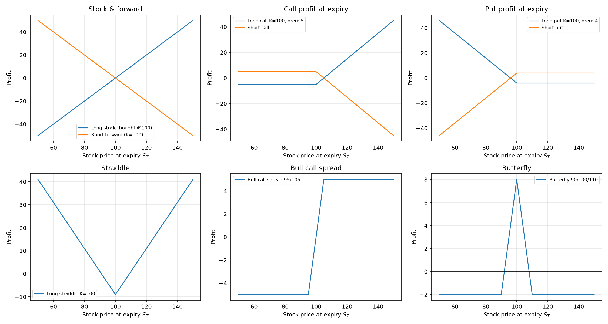
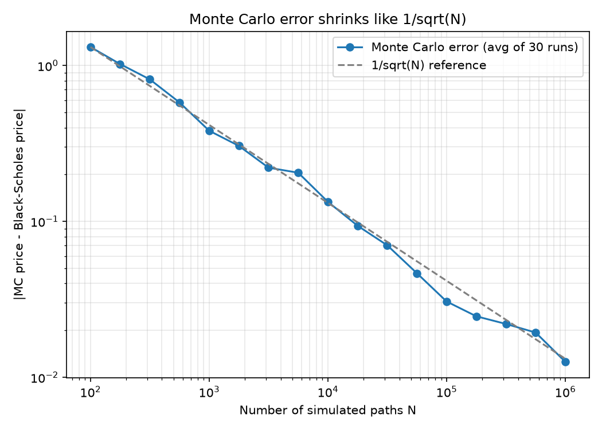
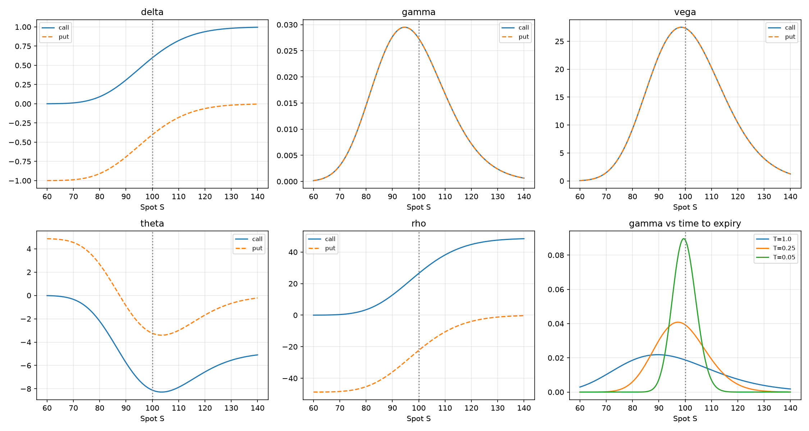
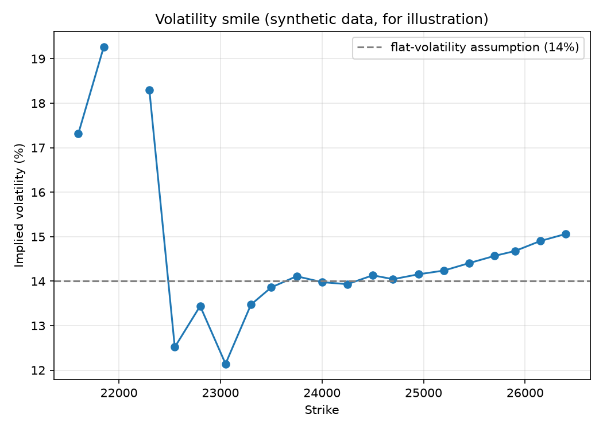
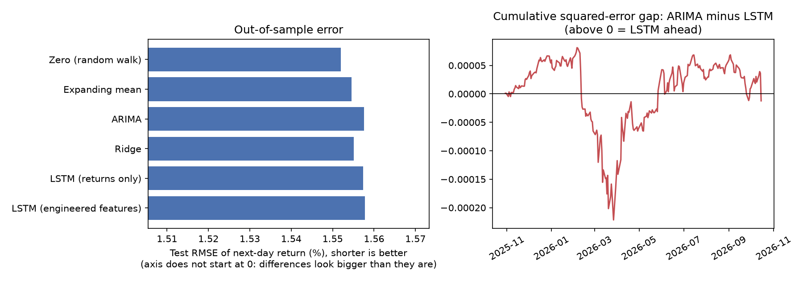

# Quants

Quantitative-finance projects, built from scratch and tested properly. Each project lives in its own folder; this page explains all of them.

| # | Project | What it is | Status |
|---|---|---|---|
| 1 | [Options Pricing Model](#project-1-options-pricing-model) · `Options_Pricing_Model/` | Prices options with a formula, a simulation and real market data, and checks they agree | Core library done · real-market validation in progress |
| 2 | [Automated Trading Bot](#project-2-automated-trading-bot) · `Automated_Trading_Bot/` | A paper-trading bot running live on a cloud server, with risk controls and public logs | **Live since 15 Oct 2026** (paper money) |
| 3 | [DSA Financial Simulator](#project-3-dsa-financial-simulator) · `DSA_Financial_Simulator/` | Dijkstra order routing and a dynamic-programming allocator on a 500-venue network, in C++ | Core done and tested · benchmark below |
| 4 | [ML Stock Prediction](#project-4-ml-stock-prediction) · `ML_Stock_Prediction/` | Walk-forward test of an LSTM against ARIMA and simple baselines on 20 NSE stocks | Done · **result: no edge over the baselines** |

> *Educational projects, not investment advice. The trading bot uses paper (simulated) money only.*

---

## Project 1: Options Pricing Model

**Pricing options three ways (formula, simulation, market data) and checking that they agree.**

 

> **Status:** core library complete and tested · validation on real NSE option prices in progress
> *Educational project, not investment advice.*

---

### What this project does

An **option** is a contract whose value depends on where a stock ends up. This project answers three questions about it:

1. **What is the option worth?** I price it with the Black–Scholes formula *and* with a Monte Carlo simulation of thousands of possible futures, then check the two agree.
2. **How does that value react when things change?** I compute the "Greeks" (delta, gamma, vega, theta, rho) three independent ways.
3. **Does the model match the real market?** I compare model prices with traded option prices and measure *where* the model is accurate and where it breaks.

Everything is written in Python (NumPy, SciPy, pandas, Matplotlib) and covered by **125 automated checks**.


### The ideas

**What is an option?**
A *call option* is the right (not the obligation) to buy a stock at a fixed price **K** (the *strike*) on a fixed date **T** (the *expiry*). If the stock ends above K you profit; if it ends below, you simply walk away and lose only what you paid for the option. A *put* is the mirror image: the right to *sell* at K.



**What is Black–Scholes?**
A formula for the fair price of that right *today*. It assumes the stock moves randomly (a "random walk" with a steady upward drift and a constant amount of jitter called **volatility**, σ). Its key insight: you can hedge the option's risk by trading the stock, so the price cannot depend on anyone's opinion about where the stock is heading.

**Why also run a simulation?**
Formulas exist only for simple options. A simulation works for almost *any* payoff, so it is the tool you reach for next. Monte Carlo pricing is simple: simulate many possible futures for the stock, compute the option's payoff in each, average them, and discount back to today. Because the formula exists for the simple case, I can use it as an **answer key to test the simulation**.



The error shrinks like **1/√N**: 100× more simulations gives only 10× more accuracy. That is why the project also implements *variance reduction* tricks (below), which get accuracy without more simulations.

**What are the Greeks?**
Dials that tell you how the option's price responds to the world changing:

| Greek | Plain-English meaning |
|---|---|
| **Delta** | If the stock moves up by 1, how much does the option move? |
| **Gamma** | How quickly does delta itself change? (Biggest near the strike, near expiry.) |
| **Vega** | If volatility rises, how much does the option gain? |
| **Theta** | How much value does the option lose each day just from time passing? |
| **Rho** | How sensitive is it to interest rates? |



---

### Quick start

```bash
git clone https://github.com/hmjag07/Quants.git
cd Quants/Options_Pricing_Model

python -m venv .venv
# Windows (PowerShell):  .venv\Scripts\Activate.ps1
# macOS / Linux:         source .venv/bin/activate

pip install -r requirements.txt
```

Try it:

```bash
python black_scholes.py     # prices an at-the-money call and put
python greeks.py            # Greeks three ways, side by side
python Mc_Engine.py         # speed benchmark + variance-reduction table
python Market_Validation.py # demo on a synthetic option chain
python make_figures.py      # regenerates every image in /images
```

---

### What's inside

All files sit in one folder and import each other.

| File | What it does |
|---|---|
| `payoffs.py` | Payoffs and profit diagrams: stock, forward, call, put, straddle, strangle, bull spread, butterfly |
| `bonds.py` | Discounting, zero-coupon and coupon bond prices, forward pricing, put-call parity check |
| `black_scholes.py` | The closed-form call/put pricer (plus a version with no SciPy, to cross-check the maths) |
| `monte_carlo.py` | Simulates stock paths: a deliberately slow loop version, and a vectorised one |
| `Mc_Engine.py` | Fast Monte Carlo pricer with variance reduction and a speed benchmark |
| `greeks.py` | Delta, gamma, vega, theta, rho: formula, finite-difference, and Monte Carlo |
| `Market_Validation.py` | Implied volatility, calibration, loading real option chains, error by moneyness |
| `explore.py` | Notebook-style cells (run in VS Code) for plotting and experimenting |
| `Make_Figures.py` | Generates the figures in this README |
| `Verify_until_greeks.py` | The automated test suite |

---

### Results you can reproduce

**Black–Scholes benchmark** (stock = strike = 100, rate 5%, volatility 20%, 1 year):

| | Price |
|---|---|
| Call | **10.4506** |
| Put | **5.5735** |

These match a hand calculation, and a textbook example from Hull (S=42, K=40, r=10%, σ=20%, T=0.5 → call 4.76, put 0.81) is built into the tests.

**Greeks for the same call** (analytical, checked against finite differences and Monte Carlo):

| Greek | Value | Read it as |
|---|---|---|
| Delta | 0.6368 | stock +1 → option about +0.64 |
| Gamma | 0.01876 | delta changes by ~0.019 per +1 in stock |
| Vega | 37.52 per 1.00 of vol (0.375 per vol point) | vol +1 percentage point → option about +0.38 |
| Theta | −6.414 per year (≈ −0.018 per day) | the option loses ~0.018 a day to time |
| Rho | 53.23 per 1.00 of rate (0.532 per 1%) | rates +1% → option about +0.53 |

**Monte Carlo accuracy:** the simulated price converges to the formula as shown in the convergence plot. Every simulated price is reported **with its standard error**, because a Monte Carlo number without an error bar is not a finished result.

**Speed:** the vectorised engine is far faster than the loop version. Run `python mc_engine.py` to see the speed-up on your machine; the benchmark prints loop time, vectorised time and the ratio.

<!-- TODO (add after running on real data): a short "Real-market validation" section with
     your data source, date, expiry and the table printed by summarize(). -->

---

### How it works

#### 1. The stock model

The stock follows geometric Brownian motion:

$$dS_t = \mu S_t\,dt + \sigma S_t\,dW_t$$

Applying Itô's Lemma to $\ln S$ gives an *exact* solution, so each simulated stock price needs no step-by-step approximation:

$$S_T = S_0 \exp\!\Big[\big(r - \tfrac{1}{2}\sigma^2\big)T + \sigma\sqrt{T}\,Z\Big],\qquad Z\sim N(0,1)$$

(For pricing, the drift $\mu$ is replaced by the risk-free rate $r$. That is *risk-neutral valuation*.)

#### 2. Two prices that must agree

**Closed form:**

$$C = S\,N(d_1) - K e^{-rT} N(d_2),\qquad d_1=\frac{\ln(S/K)+(r+\tfrac12\sigma^2)T}{\sigma\sqrt T},\quad d_2=d_1-\sigma\sqrt T$$

**Monte Carlo:**

$$C \approx e^{-rT}\,\frac{1}{N}\sum_{i=1}^{N}\max(S_T^{(i)}-K,\,0),\qquad \text{standard error}=\frac{s}{\sqrt N}$$

#### 3. Variance reduction (better accuracy for free)

- **Antithetic variates:** for every random draw, also use its mirror image. The two results partly cancel each other's luck.
- **Control variate:** the stock's *expected* final price is known exactly. Use that known quantity to correct for how lucky or unlucky the simulation was.

Both are implemented in `mc_engine.py`. `python mc_engine.py` prints the standard error for plain, antithetic, control-variate and combined versions side by side.

#### 4. The Greeks, three independent ways

| Method | Idea | Why include it |
|---|---|---|
| Closed form | Differentiate the formula by hand | The answer key |
| Finite difference | Nudge an input slightly, reprice, divide | Works for *any* pricer |
| Monte Carlo (pathwise / likelihood-ratio) | Estimate sensitivities from the simulation | Needed when no formula exists |

One detail worth knowing: **gamma needs a different estimator.** A call's payoff has a sharp corner at the strike, so differentiating along each path twice gives zero (wrong). The likelihood-ratio method fixes this by differentiating the probability instead of the payoff.

#### 5. Comparing with the real market

Backwards from a market price you can ask: *which volatility would make Black–Scholes match this price?* That is the **implied volatility**, found by root-finding. If Black–Scholes were perfectly right, every strike would give the same implied volatility. In real markets they do not: options far from the current price (especially out-of-the-money puts on indices) typically show **higher** implied volatility, a pattern called the **volatility smile** (or *skew*).



*(The figure above uses a synthetic chain with a smile built in, purely to illustrate the idea. It is not market data.)*

The practical consequence: a single-volatility model fits well **near the money** and badly **in the wings**. So errors are reported **by moneyness bucket**, not as one blended number.

---

### Use your own market data

Download an option chain (for example NSE's option-chain page or F&O bhavcopy) as a CSV. The loader recognises NSE-style column names (`StrkPric`, `OptnTp` with `CE`/`PE`, `ClsPric`) as well as simple `strike, option, market_price` files.

```python
import numpy as np
from market_validation import (load_chain_csv, forward_from_parity,
                               calibrate_flat_vol, validate_chain, summarize)

S = 24000.0        # spot of the underlying on the quote date
r = 0.065          # risk-free rate (annual, decimal) - use a current T-bill yield
T = 30 / 365       # years to expiry

chain = load_chain_csv("my_chain.csv")
F = forward_from_parity(chain, r, T)        # forward implied by the chain itself
q = r - np.log(F / S) / T                   # carry that reproduces that forward
sigma = calibrate_flat_vol(chain, S, r, T, q)

detail = validate_chain(chain, S, r, T, sigma, q)
print(summarize(detail).round(2).to_string(index=False))
```

`summarize` prints mean/median absolute % error and the share of options within 5%, by distance from the forward. Options priced below a minimum premium are excluded, since percentage errors on tiny premiums are meaningless. To download underlying price history for historical volatility, install `yfinance` and run `python market_validation.py --live`.

---

### How it is tested

Three suites (125 checks) print PASS/FAIL per check and exit with an error if anything fails. They test against **independent references**, not just against themselves:

- hand-calculated values and textbook examples
- structural identities: put-call parity, `delta_call − delta_put = 1`, equal gamma and vega for calls and puts
- limiting behaviour: deep in-the-money delta → 1, deep out-of-the-money → 0
- statistical consistency: Monte Carlo within four standard errors of the formula; error ∝ 1/√N
- round trips: price → implied volatility → price recovers the original

---

### What I learned

- **Test your tests.** Three of my own expected values were wrong at first (a butterfly's maximum profit, the exactness of put-call parity in a *finite* sample, and a price filter that correctly removed nothing). The fix each time was to work out *why*, not to loosen a tolerance.
- **A Monte Carlo price needs an error bar.** The number alone says nothing about how much to trust it.
- **Claim performance against a stated baseline.** "X% faster" means nothing without saying "than what".
- **Flat-volatility Black–Scholes fails predictably in the wings.** Reporting error by moneyness is more honest than one blended figure.

---

### Limitations

- European options only (no early exercise); no discrete dividends.
- Constant volatility and constant interest rate: no smile, no stochastic volatility.
- Market validation depends on the quote source, the closing-price timing and the chosen risk-free rate; closing prices of illiquid strikes can be stale.

### Possible extensions

Local-volatility or Heston model fitted to the smile · American options (binomial tree, Longstaff–Schwartz) · path-dependent payoffs (Asian, barrier) using the same engine · delta-hedging simulation.

---

### References

- Black & Scholes (1973), *The Pricing of Options and Corporate Liabilities*, Journal of Political Economy
- Merton (1973), *Theory of Rational Option Pricing*, Bell Journal of Economics
- Hull, *Options, Futures, and Other Derivatives*
- Glasserman (2004), *Monte Carlo Methods in Financial Engineering*
- Cvitanić, *Pricing Options with Mathematical Models* (CaltechX BEM1105x lecture series)


---

## Project 2: Automated Trading Bot

**A paper-trading bot that follows a simple trend strategy on US ETF prices through the Alpaca API, sizes every trade from a fixed risk budget, and writes an auditable log of everything it does.**

  

> **Status:** deployed and running on an AWS server since 15 Oct 2026 · live results fill in below as data accumulates
> *Paper trading only. Educational project, not investment advice.*

### What this project does

A trading bot is easy to write and hard to trust. This project is about the trust part. It answers three questions:

1. **What should the bot hold right now?** A simple trend rule (moving averages plus momentum) gives a target: long, short or flat.
2. **How much, and what if it is wrong?** Every trade risks a fixed 0.5% of the account, with a stop-loss and a profit target attached to the order, plus a daily-loss kill switch.
3. **Can anyone verify what it did?** Every order, skip and halt is written to a CSV log that is pushed to this repo every hour.

The strategy is deliberately plain. The point is a pipeline that is safe, restartable and testable. It is **not** claimed to have an edge.

### Live forward test

| | |
|---|---|
| Account | Alpaca paper account (simulated money) |
| Instrument / bars | SPY (S&P 500 ETF), hourly candles |
| Started | 15 Oct 2026 |
| Runs on | AWS EC2 (Sydney), restarted automatically by `systemd` if it crashes |
| Logs | [`bot-logs` branch](https://github.com/hmjag07/Quants/tree/bot-logs): `equity_curve.csv` and `trades.csv`, updated hourly |

Results, calculated from the live log and compared with simply holding SPY over the same dates:

| Days running | Return | Buy-and-hold SPY | Max drawdown | Sharpe | Trades |
|---|---|---|---|---|---|
| pending | pending | pending | pending | pending | pending |

A forward test needs weeks of data before the numbers mean anything, so none are quoted yet. They will be filled from `equity_curve.csv`, **never** from a backtest.

### The strategy

```
target = +1 (long)   if fast SMA > slow SMA  and  momentum > 0
         -1 (short)  if fast SMA < slow SMA  and  momentum < 0
          0 (flat)   otherwise, including while the indicators warm up
```

Defaults: 20 / 50-bar simple moving averages, 10-bar momentum, 14-bar ATR (average true range, a measure of how far the price typically moves per bar). The strategy outputs a **target position**, not "buy" and "sell" events. That one choice makes restarts safe: after a crash the bot recomputes the same target and compares it with what the broker really holds.

### Risk controls

- **Position size:** `units = equity × 0.5% ÷ (2 × ATR)`, rounded down, then capped by a unit limit and by a leverage limit (no leverage by default).
- **Exits:** a stop-loss at 2 ATR and a profit target at twice that distance, both attached to the entry order at the broker.
- **Daily-loss kill switch:** if equity drops 2% from the day's start, the bot closes everything and stops entering until the next day.
- **Error halt:** after 5 failed cycles in a row it tries to flatten the position and exits.
- **Config guard:** the settings validator refuses live trading endpoints and any risk above 5% per trade, so a typo in `.env` cannot send real money.

### How it works

```mermaid
flowchart LR
    BR["Broker (Alpaca paper)"] ----- "candles, quote, equity, position" --> BOT
    BOT["bot.py<br/>one cycle per bar"] -- "price history" --> STR["strategy.py<br/>SMA + momentum + ATR"]
    STR -- "target: +1 / 0 / -1" --> BOT
    BOT -- "equity, ATR" --> RISK["risk.py<br/>sizing, stops, kill switch"]
    RISK -- "units, stop, target" --> BOT
    BOT -- "market order + stop/target" --> BR
    BOT --> LOG["trade_logger.py<br/>trades.csv, equity_curve.csv"]
    BOT --> ST["bot_state.json<br/>last bar, blocked direction, day-start equity"]
```

One cycle, once per completed bar:

1. Fetch the latest completed candles. If the newest bar was already handled, do nothing.
2. If the position has vanished since last time, the broker's stop or target fired. Log it and block re-entering in the same direction.
3. Compute the strategy's target position.
4. Apply the safety rules (daily-loss halt, no instant re-entry after a stop-out).
5. **Reconcile:** compare the target with the broker's real position and close and/or open to match.
6. Log equity and save state.

### Design decisions

| Decision | Why |
|---|---|
| Strategy returns a target position, not trade events | After a restart the bot cannot double-trade; it just reconciles |
| Order requests are never automatically retried | A timeout can hide an order that actually filled; retrying could double the position. The next cycle re-reads the real position instead |
| Market closed is a skip, not an error | Otherwise every night and weekend would count toward the 5-error halt |
| A failed close never lets the bot open the opposite side | Prevents accidentally holding two positions |
| No re-entry in the same direction after a stop or target exit until the signal changes | Otherwise a stopped-out trade reopens on the next bar |
| The backtest runs the real `Bot.step` | A separate backtest loop could disagree with live behaviour on sizing, stops or halts |
| State is written atomically; a corrupt file falls back to a clean state | A crash mid-write cannot brick the bot |

### Quick start

```bash
git clone https://github.com/hmjag07/Quants.git
cd Quants/Automated_Trading_Bot

python -m venv .venv
# Windows (PowerShell):  .venv\Scripts\Activate.ps1
# macOS / Linux:         source .venv/bin/activate

pip install -r requirements.txt
```

1. Create a free [Alpaca](https://alpaca.markets) **paper** account and generate API keys.
2. Copy `env.example` to `.env` and fill in `ALPACA_KEY_ID` and `ALPACA_SECRET_KEY`. Never commit `.env`.
3. Run the checks, then test the connection, then run one cycle:

```bash
python verify_working.py      # 185 offline checks, no network needed
python test_connection.py --broker alpaca
python bot.py --once          # one cycle, then exit
python bot.py                 # run continuously
python backtest.py            # replay the real bot code on synthetic prices
```

The bot only trades during US market hours; outside them it logs `SKIP: market closed` and waits.

### What's inside

| File | What it does |
|---|---|
| `config.py` | Reads settings from `.env`, validates them, refuses live trading |
| `strategy.py` | Indicators and the target-position rule |
| `risk.py` | Position sizing, stop and target levels, daily-loss check |
| `bot.py` | The per-bar cycle, state saving, run loop, error handling |
| `broker_base.py` | The common broker interface that every adapter implements |
| `broker_alpaca.py` | Alpaca paper-trading adapter (the one running live) |
| `broker_paper.py` | Simulated broker for backtests and offline tests |
| `broker_oanda.py`, `broker_ibkr.py` | Early adapters for OANDA and Interactive Brokers; tested offline only, not used |
| `trade_logger.py` | Append-only CSV logs |
| `backtest.py` | Replays prices through the real `Bot.step` |
| `test_connection.py` | Read-only credential and network check |
| `verify_working.py` | The automated test suite |

### Log files

- `trades.csv`: one row per event: `ENTRY`, `EXIT`, `REJECTED`, `SKIP` or `HALT`, with side, units, price, stop, target, equity and the reason.
- `equity_curve.csv`: equity and position after every bar. Sharpe ratio and drawdown are computed from this file.

### How it is tested

`verify_working.py` runs **185 offline checks** and exits with an error if any fail. They cover position sizing, stop and target levels, the kill switch, restart and reconciliation behaviour, a look-ahead check (the strategy must give the same answer whether or not future bars exist), and the safety refusals (live endpoints, oversized risk).

I also **broke the code on purpose** (mutation testing: removing a stop, flipping a sign, disabling the kill switch) to confirm the tests fail when they should.

The backtest uses synthetic prices. It checks that the mechanics are right, and it is not used to claim returns.

### What I learned

- **A pretty total can hide a broken statistic.** My first backtest showed a +29% return but a profit factor of 0.45, because trades closed by stops and targets were not counted. Trade statistics now come from the broker's fill records.
- **A test that cannot fail proves nothing.** My kill-switch test used a loss of 0.86% against a 1% limit, so it passed whether or not the switch worked. A bigger drop plus a negative control fixed it.
- **A closed market is not an error.** Treating it as one would trip the error halt every night.
- **Linux file names are case-sensitive.** `Config.py` imports fine on Windows and fails on the server, so the test file now checks file names first.
- **A broker's free data has limits.** Alpaca's free IEX feed covers only part of US volume, so I trade a liquid ETF.

### Limitations

- **Exits executed by the broker (stop or target) are logged without price or P&L.** The bot only learns that the position disappeared. Equity in `equity_curve.csv` is the reliable record until these are reconciled from the broker's transaction history.
- The backtest fills at the bar's close plus half a spread, with no slippage or financing costs, and runs on synthetic data.
- A single instrument and a single plain strategy: this is a trustworthy pipeline, not a proven edge.
- Paper fills are optimistic compared with real markets.
- The OANDA and IBKR adapters have never run against live endpoints.

### Possible extensions

Stops calibrated with Value-at-Risk · Sharpe ratio and drawdown reported from the live record · a 90-day backtest on real historical data shown next to the live results · reconciling broker-side exits from the transaction history · latency measurement and API batching.

---

## Project 3: DSA Financial Simulator

**Graph and dynamic-programming algorithms applied to a trading problem: find the cheapest route for an order across a network of venues, then split a budget across assets. Written in C++ and benchmarked against a plain textbook baseline.**

 

> **Status:** core complete and tested · benchmark numbers below were measured on my own machine
> *Synthetic data, educational project, not investment advice.*

### What this project does

1. **Route.** A network of 500 trading venues, where every directed link has a cost in basis points (fees, half-spread, impact). **Dijkstra's algorithm** finds the cheapest way to get an order from the cash venue to any other venue.
2. **Allocate.** Given those routing costs, a **dynamic program** splits a budget of lots across assets to maximise total net value, with diminishing returns and fixed ticket fees.
3. **Prove it.** Every algorithm is checked against an independent reference, and the optimised code is timed against a baseline on identical inputs.

### The ideas

**Why Dijkstra?** Routing an order through several venues is a shortest-path problem: each hop adds a cost, and you want the cheapest total. Dijkstra finishes the nearest venue first, then the next nearest, and so on. It needs every cost to be zero or positive, so the code rejects negative costs when it builds the graph.

**Why dynamic programming and not "just buy the best lot first"?** For asset *i*, holding *k* lots is worth

```
value(i, k) = k × (alpha_i − routing_cost_i) − ½ × lambda_i × k² − fixed_i      (k ≥ 1)
value(i, 0) = 0
```

`alpha` is the expected edge per lot, `routing_cost` comes from the Dijkstra step, `lambda` penalises large size (impact, risk), and `fixed` is a one-off ticket fee. A greedy rule that keeps adding the best next lot is optimal only when returns always diminish. With a fixed fee the first lot can lose money while the second makes it back, and greedy never starts such a position. DP considers every split. The tests contain exactly that trap: DP finds a value of 10, greedy only 1.5.

### Quick start

```bash
git clone https://github.com/hmjag07/Quants.git
cd Quants/DSA_Financial_Simulator

g++ -std=c++17 -O2 -Wall -Wextra -o verify_simulator verify_simulator.cpp
g++ -std=c++17 -O2 -Wall -Wextra -o simulator simulator.cpp
g++ -std=c++17 -O2 -o benchmark benchmark.cpp

./verify_simulator     # 54 checks
./simulator            # demo: route + allocation
./benchmark            # baseline vs optimised timings
```

On Windows use `.\verify_simulator.exe`, and so on. `simulator` accepts `--nodes`, `--assets`, `--lots`, `--maxlots`, `--degree` and `--seed`.

### What's inside

| File | What it does |
|---|---|
| `network.hpp` | The venue network (compact CSR storage), a seeded random generator that gives the same network on every compiler |
| `routing.hpp` | Dijkstra two ways (plain O(V²) baseline, binary-heap optimised), Bellman-Ford as an independent cross-check, path reconstruction |
| `portfolio_dp.hpp` | The allocation DP three ways (hash-memo baseline, rolling-array optimised, full table with the chosen lots), plus brute force and greedy for the tests |
| `pipeline.hpp` | Joins routing and allocation: route costs become the value tables the DP optimises |
| `simulator.cpp` | Demo program |
| `benchmark.cpp` | Timing harness: median of 9 runs, outputs checked identical, prints a table |
| `verify_simulator.cpp` | The automated test suite |

### Results

Baseline = O(V²) array Dijkstra and a hash-memoised top-down DP. Optimised = heap Dijkstra and a bottom-up rolling-array DP. Both give identical outputs on every run (checked inside the benchmark). Median of 9 runs, compiled with `-O2`.

| Benchmark | Work per run | Baseline | Optimised | Speed-up | Time cut |
|---|---|---|---|---|---|
| Routing, 500 venues | 200 full route solves | 40.03 ms | 11.78 ms | 3.4x | 71% |
| Routing, 2000 venues | 40 full route solves | 112.91 ms | 12.64 ms | 8.9x | 89% |
| Routing, 5000 venues | 10 full route solves | 184.78 ms | 9.10 ms | 20.3x | 95% |
| DP, 30 assets, 300 lots | 20 allocations | 27.04 ms | 1.92 ms | 14.1x | 93% |
| Full pipeline, 500 venues | 100 ticks (route + allocate) | 143.83 ms | 16.63 ms | 8.7x | 88% |
The speed-up is measured against my own deliberately plain baseline, not against a production library. It grows with network size because the baseline scans every venue on every step.

### How it is tested

`verify_simulator` runs **54 checks** and exits with an error if any fail:

- hand-worked examples, including a textbook shortest-path graph and an allocation worked out by hand
- the array, heap and Bellman-Ford routing algorithms must agree on 300 random graphs, which include zero-cost edges, parallel edges and unreachable venues
- an optimality certificate: no edge can still improve any distance
- every reconstructed path must use real edges and cost exactly the reported distance
- the DP must match brute force on 300 small random instances, including negative values
- bottom-up, rolling and top-down DP must agree, and greedy must equal DP when every asset is concave
- properties: a bigger budget never lowers the optimum, and dearer routing never raises it

The suite also runs clean under AddressSanitizer and UndefinedBehaviorSanitizer. I **broke the code on purpose** 14 ways (a max-heap, a missing reverse edge, an off-by-one in the DP, greedy buying losing lots, and so on) and the tests caught every real fault.

### What I learned

- **My own tests found a real bug.** I reversed a path by assigning a vector from its own reverse iterators, which is undefined behaviour. The path checks failed immediately.
- **A hang is also a failure.** Relaxing with `<=` instead of `<` loops forever on zero-cost cycles, which only a test with zero-cost edges can reveal.
- **Random number distributions differ between compilers.** I wrote a small seeded generator so the same seed builds the same network everywhere.
- **A speed-up needs a stated baseline.** "Faster" means nothing without "than what", and without checking that the outputs are identical.

### Limitations

- Costs are synthetic and not calibrated to any market. Hop costs are additive and do not depend on order size.
- There is no order matching at each venue, only the routing and allocation layers.
- Single-threaded; the baseline is a textbook implementation, so the speed-ups describe the gap to that baseline.

### Possible extensions

Size-dependent edge costs · an order-book matching engine at each venue · splitting one order across several routes (k-shortest paths) · detecting arbitrage with Bellman-Ford on log exchange rates · parallel routing.

---

## Project 4: ML Stock Prediction

**Can an LSTM predict the next day's return of NSE stocks better than ARIMA? A strict out-of-sample test with honest baselines, proper statistics, and tests that prove the pipeline cannot cheat.**

  

> **Headline result:** no. On a held-out year (238 trading days, 20 stocks) the LSTM is statistically indistinguishable from ARIMA, and **predicting "no change" is the most accurate forecast of all.** That is the normal finding for daily returns, and the interesting part of the project is how carefully it was established.
> *Educational project, not investment advice.*

### What this project does

1. **Data.** About 5 years (1 Oct 2021 to 16 Oct 2026) of daily adjusted prices for 20 large NSE stocks in 5 sectors (banks, IT, FMCG, auto, energy) plus the NIFTY 50 index, from Yahoo Finance.
2. **Features.** For each stock and day: the last 5 daily returns, 5/20/60-day momentum, 5/20-day rolling volatility, 20-day momentum relative to its sector and to the index, the index's own return and volatility, and a volume z-score. Everything uses data up to that day's close only.
3. **Target.** The stock's **next-day log return**.
4. **Models.** Predict zero (the random walk), the stock's running average return, **ARIMA** (one per stock, re-estimated every 21 days), **Ridge** regression on the same features, and an **LSTM** trained on all stocks together (once on returns alone, once on all features; the final prediction averages 5 random seeds).
5. **Judge.** The last 20% of days (30 Oct 2025 to 15 Oct 2026) is touched only once, at the end.

### Why next-day returns, not prices

A one-step price forecast has error `price × (predicted return − actual return)`, so comparing return forecasts is the same comparison as comparing one-step price forecasts, without price level inflating the numbers. A model that "tracks the price closely" on a price chart usually just repeats yesterday's price; the zero-return baseline captures exactly that.

### Results

Test period 30 Oct 2025 to 15 Oct 2026, 20 stocks, 4,760 forecasts. RMSE is the typical size of the error in the next-day return, in percent.

| Model | RMSE (%) | MAE (%) | Direction acc. (%) | vs ARIMA RMSE (%) | 95% CI | DM p |
|---|---|---|---|---|---|---|
| Zero (random walk) | 1.552 | 1.115 | - | +0.4 | [+0.1, +0.6] | 0.011 |
| Expanding mean | 1.555 | 1.117 | 49.8 | +0.2 | [+0.1, +0.3] | 0.020 |
| ARIMA | 1.558 | 1.120 | 50.2 | - | - | - |
| Ridge | 1.555 | 1.118 | 48.4 | +0.2 | [-0.1, +0.5] | 0.297 |
| LSTM (returns only) | 1.557 | 1.120 | 48.1 | +0.0 | [-0.2, +0.3] | 0.904 |
| LSTM (engineered features) | 1.558 | 1.120 | 48.8 | -0.0 | [-0.4, +0.4] | 0.955 |

Single LSTM seeds (test RMSE %): 1.562, 1.566, 1.557, 1.561, 1.555. The table uses the average of the five.



**Reading it.**

- The LSTM with engineered features has **-0.0% RMSE relative to ARIMA** (95% interval -0.4% to +0.4%, Diebold-Mariano p = 0.955): no difference.
- **Predicting zero beats ARIMA** (+0.4%, p = 0.011). Fitting ARIMA to the past adds noise rather than signal.
- Direction accuracy is about 50% or below for every model (the best is ARIMA at 50.2%), so there is no directional edge either.
- The right-hand chart shows the LSTM ahead of ARIMA until January 2026, behind it from February to April, and back near level since. A single window of a few months would have supported either story. This is why the whole year, an interval and a significance test are reported rather than a favourable stretch.
- The seeds differ by up to 0.011 percentage points, as much as the differences between models, so one lucky seed could fake a "win".

### How the comparison is kept fair

- **Walk-forward by date, never shuffled.** Train 60% of days, validate 20%, test 20%. The scaler is fitted on training days only. Validation data picks the LSTM size and stops training early; the test period is never used for any decision.
- **ARIMA gets the same courtesy.** Its order is chosen on training data only, and each forecast uses returns up to that day and nothing later.
- **Statistics are done per day, not per stock-day.** Stocks on the same day move together, so treating all 4,760 forecasts as independent would overstate certainty. The Diebold-Mariano test uses day-level errors with a Newey-West correction for autocorrelation, and the confidence interval is a block bootstrap over days.
- **A linear model is included.** Ridge shows whether the LSTM adds anything beyond a straight line on the same features. It does not.

### Quick start

```bash
cd Quants/ML_Stock_Prediction
pip install -r requirements.txt            # TensorFlow needs Python 3.9 to 3.13

python verify_ml.py                        # 46 quick checks, about 5 seconds
python data.py --start 2021-10-01 --out prices.csv       # needs internet
python run_experiment.py --prices prices.csv            # 10 to 25 minutes
```

`python verify_ml.py --full` adds two end-to-end runs on synthetic data (about 6 minutes). `python run_experiment.py --synthetic --signal 0` runs the pipeline on pure noise. Results land in `results/`.

### What's inside

| File | What it does |
|---|---|
| `data.py` | Downloads and cleans the prices (rejects duplicates and bad prices, handles gaps) |
| `features.py` | Builds the features and the next-day target, using past data only |
| `baselines.py` | Zero, running mean, ARIMA walk-forward, Ridge |
| `lstm_model.py` | Windowing, training-only scaling, the LSTM, seed ensembling |
| `evaluate.py` | RMSE, MAE, direction accuracy, Diebold-Mariano test, block bootstrap |
| `run_experiment.py` | The whole experiment and the report |
| `synthetic.py` | Fake data for testing the pipeline, with or without a planted signal |
| `verify_ml.py` | The automated checks |

### How it is tested

`verify_ml.py` runs **46 quick checks** (52 with `--full`):

- **No look-ahead.** Deleting the future must not change any past feature or ARIMA forecast, and corrupting later prices must not change earlier features. The same tests also confirm that changes to *past* data do move the results, so the tests can fail.
- Every feature value is recomputed by hand for a sample stock and day; the target must be the next day's return; each LSTM window must be the last 20 days ending on the right day.
- The scaler and the LSTM's training and validation tensors must not change when the test period is wrecked.
- RMSE, MAE, direction accuracy, the Diebold-Mariano test (including its false-positive rate on equal models and on autocorrelated data) and the bootstrap are checked against hand calculations.
- **The pipeline must find nothing in noise but must find a real effect.** On synthetic returns with no predictability, no model shows a significant edge over predicting zero. With a deliberately planted effect, the engineered-feature models beat ARIMA with an interval clearly above zero, while ARIMA and the returns-only LSTM cannot see it. So the null result on real data is a finding about the market, not a broken pipeline.

I also **broke the code on purpose** (features that peek one day ahead, ARIMA that sees one future observation, a scaler fitted on the test period, a statistical test without its autocorrelation correction) and tightened the tests until each one was caught.

### What I learned

- **The honest answer can be "nothing".** The natural hope is an LSTM that beats ARIMA by a clear margin. The proper test says there is no such margin, and a good evaluation has to be willing to report that.
- **The baseline matters more than the model.** "Predict zero" beat ARIMA. Without it, any model that merely tracks yesterday's price looks impressive.
- **Seeds can fake a result.** Five identical LSTMs differ by as much as the gaps between models, so the answer cannot depend on a single run.
- **A test is only worth anything if it can fail.** Several of my first tests passed against deliberately broken code, which showed they were too weak.

### Limitations

- **Survivorship bias.** The 20 stocks are today's large caps; companies that fell out of the index are not in the data.
- **One test year, 238 days.** The test is only sensitive to differences of roughly half a percent in RMSE. A smaller real effect would not be detected.
- Daily horizon, no transaction costs, no trading rule. A small forecast edge could still matter or fail to matter once costs are included, and this project does not test that.
- Only one LSTM design family with a small tuning grid (16, 32 or 64 units).

### Possible extensions

A longer history (10 years) for more power · predicting direction or volatility instead of returns, where there is more structure · cross-sectional ranking of stocks instead of forecasting each one · a transformer or gradient-boosted trees as the model · adding a trading rule with costs.

---

## Author

**Harsh Jagtap**: B.Tech Electrical Engineering, VJTI Mumbai · [GitHub](https://github.com/hmjag07) · [LinkedIn](https://linkedin.com/in/harsh-jagtap-8b186928b)
